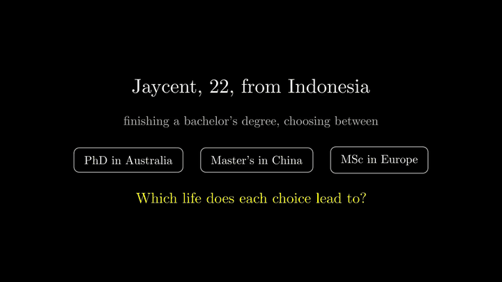
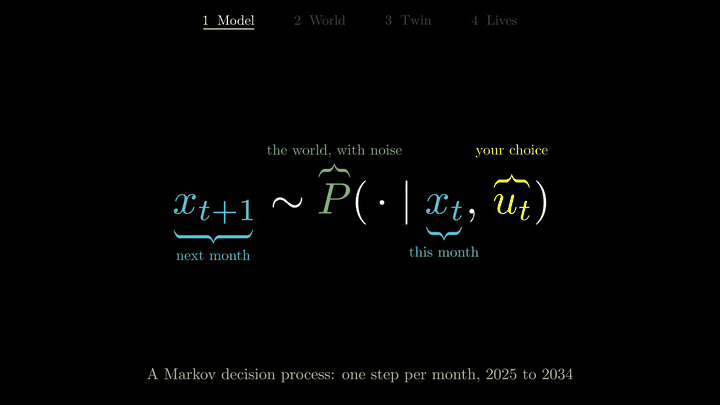
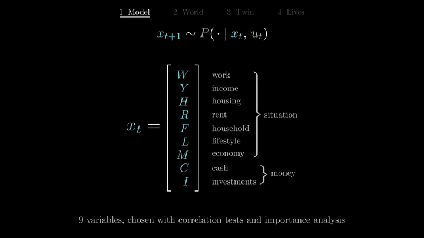
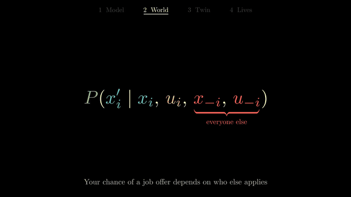
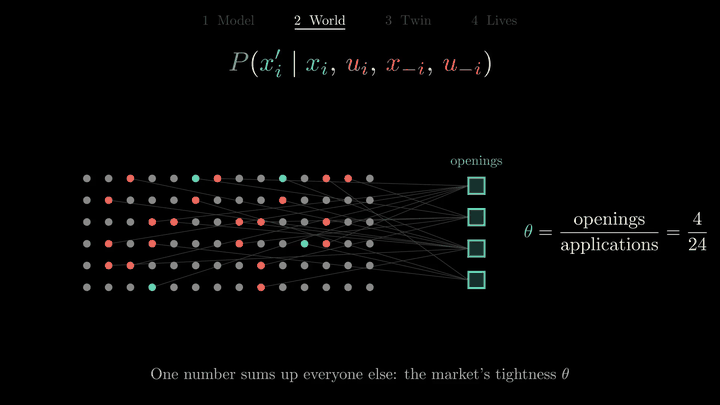
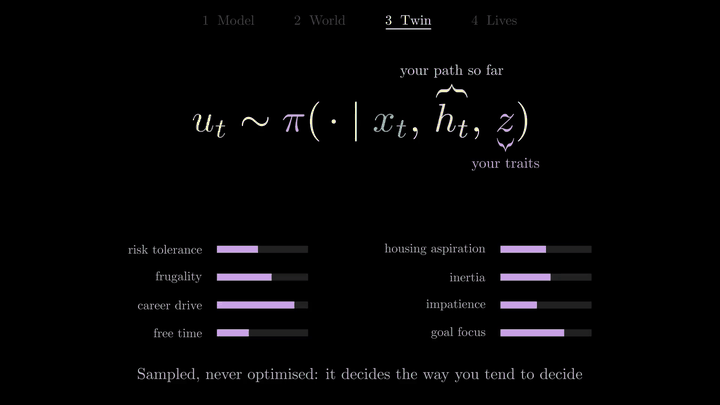
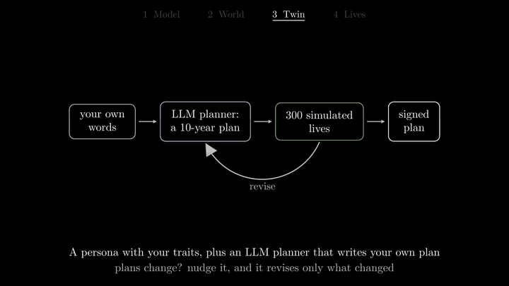

# Parallel: one choice, thousands of lives

Parallel is an AI Financial Twin, built at LauzHack 2026 for the UBS challenge ([CHALLENGE.md](CHALLENGE.md)). For one fictional person, it simulates thousands of possible lives from January 2025 to December 2034. It then shows how a decision changes their odds of reaching a savings goal, of running out of cash, and the spread of their net worth. It does not forecast one future or recommend a choice: it makes the possible futures explorable.

**Try it:** [lauzhack-financial-twin.vercel.app](https://lauzhack-financial-twin.vercel.app/) · Team: Anooj Sathyan, Guillem Masdemont, Plabon Shaha, Jaycent Gunawan Ongris

## 1. A life as a Markov decision process

Next month depends on this month, your choices and luck. One step is one month, 120 steps in all:

$$x_{t+1} \sim P(\,\cdot \mid x_t, u_t), \qquad u_t \sim \pi(\,\cdot \mid x_t, h_t, z)$$

$P$ is the world and $\pi$ is the person. The person sees the state $x_t$, their own path so far $h_t$ and their traits $z$. Nothing is optimised: we sample $\pi$ the way the person tends to decide.



## 2. State and actions

The state is nine numbers: work mode, income, housing size, rent, household, lifestyle, economy, cash and investments. Clocks are added for time in the current situation, study left and open searches, so that next month depends on the state alone. We chose these by measuring the challenge data, and the details are in [pipeline/02](pipeline/02-state-and-actions.md):
- Income explains 94% of the monthly cash flow, and 77–94% of the differences in outcomes.
- Rent explains 4–12%.
- Within each work status, income does not depend on age.



Every January the person makes four choices: work, housing, lifestyle and savings. That gives 5·3·3·3 = 135 combinations, minus those the state forbids. We kept the levers that changed outcomes when we tested 29 candidates on all 1,200 profiles. Debt decisions changed under 2% of outcomes and were dropped.



## 3. The world, $P$

Each month runs in four stages:
1. **The action is applied.**
2. **Events are drawn:** job loss, promotion, family events, the economy.
3. **The net cash flow is drawn** from a neural network trained on 28,800 person-months. It is a mixture of five Gaussians, $y \sim \sum_k w_k(x)\,\mathcal N(\mu_k(x), \sigma_k^2(x))$, so bonuses, bills and fees each get their own peak. Five copies of the network trained with different seeds measure the model's own uncertainty.
4. **The books are updated exactly:** cash, investments, loans and credit.

The data never shows anyone getting a job, a study place or a flat. Those chances also depend on everyone else, $-i$, who competes for them:

$$P(x_i' \mid x_i, u_i, x_{-i}, u_{-i})$$

We simulate 195 Swiss societies, 90,000 people over 10 years, competing for limited jobs, study places and flats. The societies are calibrated to SECO and BFS statistics.



Everyone else enters through one number, the market tightness $\theta = \text{openings} / \text{applications}$: this is a mean-field approximation. We fit $P(x_i' \mid x_i, u_i, \theta)$ on 523,000 simulated applications. The person cannot see $\theta$, so we average it out over the economy $M$:

$$P(x_i' \mid x_i, u_i) = \mathbb E_{\theta \mid M}\big[P(x_i' \mid x_i, u_i, \theta)\big]$$



## 4. The person, $\pi$

The persona has eight traits: risk tolerance, frugality, career drive, free time, housing aspiration, inertia, impatience and goal focus. They come from the profile and a short questionnaire. At each review, every option $o$ gets a score $s_o(x, h, z)$, and the choice is sampled with $\pi(o) \propto \exp(s_o / T)$, where the temperature $T$ sets how random the person is.

An LLM planner writes the person's own plan. It turns their words ("a master's next year, then a bigger flat") into yearly steps with fallbacks, tests them in 300 lives and revises them. When plans change it edits only what changed. The plan decides what it names, and habits decide the rest.



## 5. Thousands of lives

Each choice is simulated over 2,000 lives, which takes about 2 seconds. Baseline and alternative use the same random draws, so differences come from the decision, not from luck. An LLM explains the results using only the simulator's numbers.



In the example, a 22-year-old weighs a PhD, a master's or starting work. The model can represent programme types but not countries, so the comparison runs in the Swiss-calibrated world.

## Assumptions

| | Assumption |
|---|---|
| Data | 1,200 synthetic Swiss profiles over 24 months, in CHF |
| Effect of a choice | The person moves into a situation others already occupy, keeping their rank in pay and rent (nobody changes situation in the data) |
| Long run | Pay grows 1.4% a year and prices 1.0%; years 3–10 rest on these trends |
| Events and markets | Stated monthly rates, such as job loss 0.3% (1% in a recession); returns 6% ± 10 (normal), −15% ± 25 (recession); credit costs 8% a year, up to 3 × monthly pay |
| Others | Mean field: one person does not move $\theta$ |
| Behaviour | Traits, questionnaire and the person's own plan; the data contains no decisions to fit |
| Out of scope | Other countries and currencies, taxes, pension pots, home ownership |

Every assumed number is one line in [`twin/world/priors.yaml`](twin/world/priors.yaml), so it can be changed to create a scenario.

## Does it work?

Each block is tested on data it was not fitted on.

**Cash-flow network.** On people held out of training, it beats a hand-calibrated model on 2026 monthly flows: CRPS 409 vs 421. It predicts 60.9 people running out of cash in 2026, against 61 observed, and it reproduces all seven patterns in the data.

**Monthly updating.** Predicting each 2026 month before revealing it flags 26 of 28 new cash shortfalls in advance.

**Markets.** On societies never seen in training, of up to 5,000 people, calibration error stays within 3 points. The fitted effect of $\theta$ is 0.91, where theory predicts 1.

**Accounting and tests.** The accounting identities hold every month, and all 82 automated tests pass.

**Where it fails.**
- The synthetic data is simple, so fitting it well proves less than it would on real records.
- What happens after a change of situation cannot be checked, because no one in the data changes situation.
- Spells without work come out too short: 3.5 months, against 6.5 in the BFS figures.
- Behaviour is plausible but not validated.
- Most simulated students cross the credit limit, because family support isn't modelled.

The full evidence is in [pipeline/07](pipeline/07-validation.md) and [pipeline/09](pipeline/09-limitations.md).

## Run it

```bash
pip install -e '.[api]'
python -m twin train                       # fit the world model and run the acceptance tests (~3 min)
python -m twin explore P00003              # 2,000 lives and what-ifs, as an HTML report
python -m uvicorn twin.api:app --env-file .env    # API for the web app (see web/README.md)
PYTEST_DISABLE_PLUGIN_AUTOLOAD=1 python -m pytest tests -q
```

| Folder | What |
|---|---|
| [`twin/`](twin/) | Simulator: world model, persona, planner agent, API |
| [`twin_game_theory/`](twin_game_theory/) | Simulated Swiss society and the learned market models |
| [`web/`](web/) | React app |
| [`pipeline/`](pipeline/) | The whole pipeline explained, with validation and what we tried |
| [`presentation/`](presentation/) | Manim presentation (`parallel.html`, built from `slides.py`) |
| [`analysis/`](analysis/) | Data audit, state and action selection |

Synthetic data only; not financial advice. The challenge concept and materials are by Stefania Stan ([CHALLENGE.md](CHALLENGE.md)).
