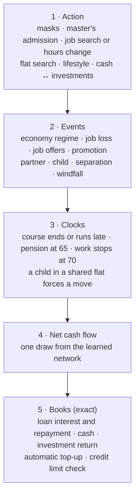

# 3. The transition function: one month of a life

**In short.** `World.step` in [`twin/world/env.py`](../twin/world/env.py) moves thousands of lives
forward by one month at once. It applies the action, draws the month's events, draws the month's
net cash flow from a learned network, and then updates the books with exact accounting. Each
piece comes from the best source available for it: the ledger where the data can teach it, a
simulated society for markets, and stated assumptions for the rest.

## The order inside one month

The order matters. For example, the month's flow is drawn *after* a job offer has changed the
work mode, so the first month of a new job already has the new pay.

## The pieces and where each comes from

| Piece | Source | How |
|---|---|---|
| Net cash flow of the month | Ledger, 28,800 person-months | Mixture density network, 5-seed ensemble, per-person offset ([`flow.py`](../twin/world/flow.py)) |
| Pay after a change of work mode | Pay by work mode in the profiles | Keep the person's pay rank, read the new pay off the new mode's distribution ([`redraw.py`](../twin/world/redraw.py)) |
| Rent after a move | Rent by city and tier (R² 0.66) | Log-rent = level + tier + city + the person's own residual |
| Pay and price drift | Ledger trends | Pay index +1.42% a year, price index +1.01% a year (3% in an inflation regime) |
| Job offers, admission, flats | Simulated Swiss society | Three small regression models ([04](04-markets.md)) |
| Job loss, promotion, family, economy, returns, windfalls, credit | Assumptions | [`priors.yaml`](../twin/world/priors.yaml), one value per line |
| Cash, investments, loans | Accounting | Exact code |

## The learned part: the monthly flow network

**What it predicts.** Not one number: a *distribution* over next month's net cash flow. A mixture of
five Gaussians can put the December bonus, the February and August bills and the student fees in
separate bumps, which a single average cannot.

**Inputs** (80 numbers): work mode, self-employed and pensioner flags, log pay and log rent (in real
terms), city, calendar month, and work mode × calendar month.

**Model.** Two hidden layers of 64 units (SiLU), trained by negative log-likelihood with AdamW and
weight decay, early stopping on 10% of the *people* held out. Five seeds make an ensemble.

| Design choice | Why |
|---|---|
| Real terms; pay and price indices outside the network; no calendar year as input | The data covers 2 years, the twin runs 10. A network that saw the year would be asked about years it never saw. A test checks the year is never an input. |
| Work mode × month inputs | Without them the network under-fits rare spikes: 39 students' February and September fees and the employees' December bonus |
| Each simulated life keeps one ensemble member | Disagreement between members becomes a visible source of spread: "what the model does not know" |
| A per-person offset, shrunk towards zero | Carries what the inputs cannot see (one person's unusually high costs). Shrinkage is a random-intercept estimate, $\kappa = \sigma_b^2 / (\sigma_b^2 + \text{noise}/n)$. A new person gets zero with the population variance. |
| Lifestyle, economy and children applied after the network | They never vary in the data, so the network cannot learn them; they enter as explicit adjustments |

**Why not one network for the whole step?** Two reasons. Accounting is exact, so a network could
only add error to it. And nobody changes situation in the data, so a network trained on whole
steps would learn that actions do nothing.

**How an action takes effect.** A person who takes a full-time job gets the full-time pay at their
rank, and from then on the network draws the flows of a full-time person with that pay and rent.
The action moves the person into a situation other people already occupy. This is how the synthetic
ledger was generated, so it is exact here; on real data it would be an assumption to test.

## The fitted part: pay and rent when something changes

* **Pay.** In the data, pay depends on the work mode and on nothing else we can see (not age, city
  or rent, see [01](01-data.md)). So each person has a pay rank $u \in (0, 1)$ and their pay is the
  $u$-quantile of their mode's pay distribution. Not working splits into benefits (under 65) and
  pensions. A new job moves the rank a little (noise 0.3 in normal-score units), a promotion moves
  it up 0.25, a finished master's adds 20 percentiles.
* **Rent.** $\log R = a + b_{\text{tier}} + c_{\text{city}} + \sigma z$. The person keeps $z$, their
  taste for pricier or cheaper flats, when they move.

## The assumed part

Everything the data cannot show is one line in [`priors.yaml`](../twin/world/priors.yaml), so each
can be questioned and changed. A few of them:

| Assumption | Value |
|---|---|
| Job loss per month | 0.3%, 1.0% in a recession |
| Promotion per month | 0.7%, 0.3% in a recession |
| Partner moves in / child / separation per month | 0.4% (single, under 45) / 0.7% (couple, under 42) / 0.2% |
| Economy | 0.5% a month into inflation or recession each; back to normal at 4% or 6% a month |
| Returns a year (mean, sd) | normal 6% ± 10, inflation 1% ± 12, recession −15% ± 25 |
| Credit | 8% a year below zero; limit max(3 × monthly pay, CHF 5,000) |
| Child, move | CHF 1,800 a month; CHF 2,000 once |
| Master's | 24 months (data, S001); 10% chance it runs 6 months late |

Each one is also a scenario lever: change the value, re-run, compare.

## The exact part: the books

Every month, for every life:

$$C' = C + \text{flow} + \text{lifestyle} - \text{child} - \text{tuition} - \text{one-offs} - \text{moving} - \text{loan payment} + 8\% / 12 \cdot \min(C, 0)$$

$$I' = (I + \text{transfer}) \cdot (1 + r_M), \qquad D' = D + \text{interest} - \text{loan payment} \ge 0$$

* Transfers between cash and investments leave net worth unchanged (tested).
* If cash goes below zero and investments exist, a standing order sells investments back to one
  month of outgoings. It is a rule, not a decision.
* A breach of the credit limit is flagged; it fails any goal whose deadline comes after it. The
  life continues so its consequences stay visible.

## Randomness you can control

Every source of randomness draws from its own seeded stream: traits, model member, policy, events,
flow, market returns, person attributes. Two runs with the same seed see the same luck. This gives
two things:

* **Paired what-ifs.** "Start a master's" and "don't" are compared on the same random numbers, so the
  difference comes from the choice alone (common random numbers).
* **Spread decomposition.** Switching all streams but one off shows how much of the spread comes
  from who the person is, what they choose, luck, and what the model does not know
  ([07](07-validation.md)).

Reproduce: `python -m twin train` fits the network and the redraws and runs the acceptance tests.
