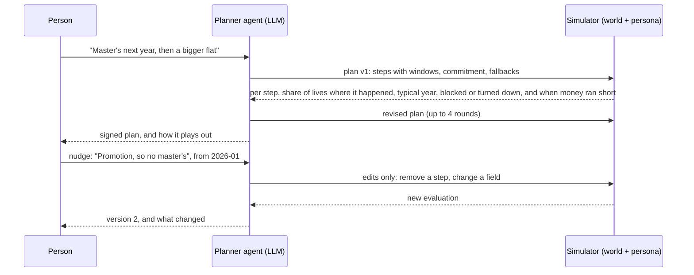

# 6. The planner agent: the person's own long-term plan

**In short.** The persona knows how people *like* this one tend to decide; it cannot know what *this*
person intends. The planner agent writes that down. An LLM speaks as the person's planning self,
turns their own words ("a master's next year, then a bigger flat") into a 2025–2034 plan, and tests
it in a few hundred simulated lives. It then revises the plan and signs it. When the person's plans
change, they "nudge" it and the agent revises only what the change affects.

Code: [`twin/plan/`](../twin/plan/). Details and the CLI: [`twin/README.md`](../twin/README.md).

## Why an agent, not a better clone

Before this, plans came from the GRU persona cloned from LLM answers ([05](05-persona-policy.md)).
That model is fitted to *people in general in this situation*. A personal twin needs the person's
own intentions: a degree they have decided on, a move they are saving for, what they would do if
they lost their job. The persona stays as the **habit layer** under the plan: it decides everything
the plan does not mention.

## The loop

## A plan, and how the simulator carries it out

A plan is a short narrative plus up to 16 **steps**. Each step is one of the four choices with an
option (for example `status: start_masters` or `housing: bigger`) and:

| Field | Meaning in the simulator |
|---|---|
| `start` / `until` | A window. The step falls due at the first January review in it and is retried each January while it is not possible or the world says no (no admission, no flat). |
| `commitment` | The chance of following through when the step is possible; declining ends the step |
| `after` + `after_months` | Wait until another step has really happened, not just been chosen |
| `event` + `within_months` | A contingency: only after a job loss, offer, graduation, partner, child, separation or windfall |
| `cash_months_below/above`, `min_age/max_age`, `repeat` | Conditions, and "every year" |

The plan compiles into the persona's stated **intentions** ([05](05-persona-policy.md)), so the
same plan works with every base policy. A per-plan **spontaneity** sets how often an unplanned change
of work or home that the habits would make still happens. With spontaneity 1 and no steps, the plan
reproduces the habits exactly.

"Happened" is strict. A move counts only when the flat search actually finds a flat. A master's
counts only when the person is admitted.

## What the agent sees after each round

For every step: the share of lives where it happened and the typical year, where it was never
possible and which rule blocked it, where the person declined, and where they tried but the world
said no. It also sees when and in what situation cash first crossed the credit limit (for example
"2027, while studying, on CHF 708 a month"), so a fallback can address that cause.

The agent is told to fix **feasibility**, not to chase better numbers: it is the person's plan, not
an adviser's. It may sign only after it has seen at least one simulation. A plan it never signs is
returned marked "not signed".

## Nudges are edits, not rewrites

A nudge is answered with **edits**: remove these step ids, change these fields. Steps the update does
not mention cannot drift. Steps whose window closed before the nudge's "as of" month are kept as they
were. Small models repeat a few slips; these are repaired and reported back to the agent: a no-op
step is dropped, and `after` naming an event becomes an `event` trigger.

## A real run: Mia

The web UI's example page shows a real run with Qwen3-8B on a local vLLM server
([`web/src/example-plan.json`](../web/src/example-plan.json)). Mia is a fictional 27-year-old employee
in Lausanne with CHF 12,000 in cash and an emergency-savings goal of CHF 15,000. 300 lives per plan;
"habits" is the same person on the same random numbers without the plan.

**Version 1.** Her words: a master's next year, then full-time work and a bigger flat; cut back
rather than touch investments. The agent signed after 2 rounds.

| Step | Happened in | Typical year |
|---|---|---|
| Start a master's (2026–2027) | 82% of lives (17% declined) | 2026 |
| Bigger flat, 3 years after the master's | 46% | 2029 |
| Cut back if I lose my job | 9% | 2031 |
| Cheaper flat if cash runs below 1 month | 27% | 2028 |

| | Plan | Habits alone |
|---|---|---|
| Goal met by Dec 2029 | 23% | 88% |
| Credit limit breached | 76% | 9% |
| Median net worth 2034 | CHF 373k | CHF 357k |

The agent saw that cash crossed the credit limit in 76% of lives, typically in 2027 while studying.
It added the cash fallback and kept the master's, because that is what she wants.

**Version 2.** Nudge as of January 2026: "my employer offered me a promotion if I stay, so no
master's; I'd still like a bigger flat, around 2027." The agent removed the master's, set the flat
to 2027–2028 and kept both fallbacks.

| | Plan | Habits alone |
|---|---|---|
| Goal met by Dec 2029 | 93% | 88% (difference +5.7 points, Monte Carlo 95% interval +2.3 to +9.0) |
| Credit limit breached | 4% | 9% |
| Median net worth 2034 | CHF 316k | CHF 357k (the bigger flat costs rent) |
| Bigger flat | in 61% of lives, typically 2027 | |

## Cost and checks

* On one L4 GPU with Qwen3-8B, a draft takes 1–3 minutes and a nudge 40 seconds to 2 minutes. The
  API runs them as background jobs because HTTPS tunnels drop requests after about 100 s.
* [`tests/test_plan.py`](../tests/test_plan.py) has 15 tests:
  * a window retries until the step is possible;
  * `after` waits for the step it follows;
  * a contingency waits for its event;
  * the habits change work and home only within the plan's spontaneity;
  * the agent signs only after a simulation;
  * a nudge touches only what it names and keeps the past.

Regenerate the example: `python -m twin.plan.make_example` (needs an LLM endpoint).
