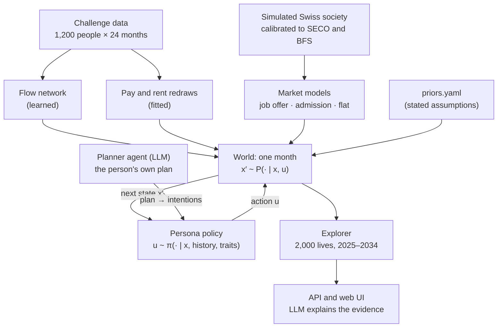

# How the Financial Twin works

This folder explains the whole pipeline in plain language: what goes in, how one simulated month
is built, who makes the decisions, how well each part performs, what we tried before, and what is
still weak. Each file is short and stands on its own. Numbers are taken from the code and its saved
results; where we re-ran something to check it, the file says so.

## The pipeline in one picture



A life is a Markov decision process with one step per month, from January 2025 to December 2034.
The **world** samples what happens next. The **persona** decides the way this person tends to
decide, at random. Nothing is optimised. Running thousands of lives shows what is likely, what is
possible and what drives the difference.

## Read in this order

| # | File | Question it answers |
|---|---|---|
| 1 | [01-data.md](01-data.md) | What does the data tell us, and what can it never tell us? |
| 2 | [02-state-and-actions.md](02-state-and-actions.md) | Why these state variables and these four choices? |
| 3 | [03-transition-function.md](03-transition-function.md) | How is one month simulated, and why is it built this way? |
| 4 | [04-markets.md](04-markets.md) | Where do job offers, study places and flats come from when the data has none? |
| 5 | [05-persona-policy.md](05-persona-policy.md) | Who makes the decisions, and how? |
| 6 | [06-planner-agent.md](06-planner-agent.md) | How does the person's own long-term plan get in? |
| 7 | [07-validation.md](07-validation.md) | How well does each part perform? All the tests in one place. |
| 8 | [08-what-we-tried.md](08-what-we-tried.md) | What we tried, what failed, and why we kept what we have. |
| 9 | [09-limitations.md](09-limitations.md) | What is still weak, and what would make it more reliable. |

## What is learned, fitted, assumed or exact

| Part of the transition | Source | Kind |
|---|---|---|
| Next month's net cash flow | 28,800 person-months of the ledger | **Learned**: a mixture density network, 5-seed ensemble |
| Pay after a change of work mode | Pay by work mode in the 1,200 profiles | **Fitted**: the person keeps their pay rank |
| Rent after a move | Rent by city and housing size (R² 0.66) | **Fitted**: log-rent model, the person keeps their residual |
| Job offers, master's admission, finding a flat | A simulated society calibrated to Swiss statistics | **Learned** from simulation: three small regression models |
| Job loss, promotions, family events, economy, returns | Nothing in the data | **Assumed**: one editable file, [`twin/world/priors.yaml`](../twin/world/priors.yaml) |
| Cash, investments, loans, credit | Accounting rules | **Exact** code, tested every month |
| Decisions | Persona traits, the person's answers, their plan | **Behaviour model**, sampled, never optimised |

## Reproduce the numbers

```bash
python -m twin train                                   # ~3 min: fit the world, run the acceptance tests
python -m twin validate                                # re-run the acceptance tests on the saved model
python -m twin_game_theory.world.build                 # ~2–3 min: rebuild the market models
python -m twin explore P00001                          # one person, 2,000 lives, HTML report
PYTEST_DISABLE_PLUGIN_AUTOLOAD=1 python -m pytest tests twin_game_theory/world/test_transition.py -q
```

Synthetic data only. The twin shows possibilities under stated assumptions; it is not a forecast
and not financial advice.
